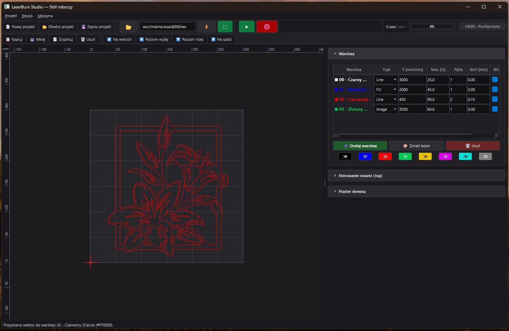
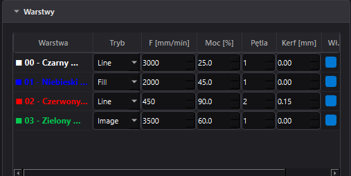
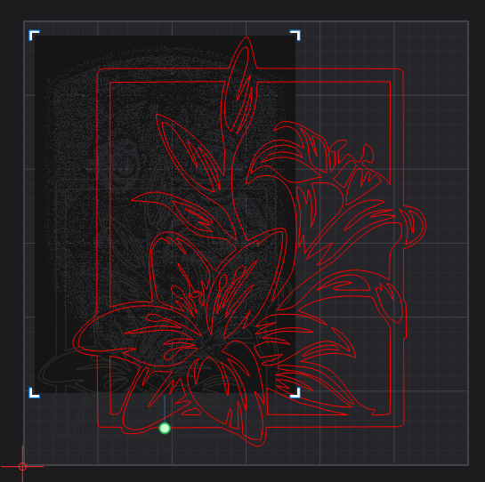
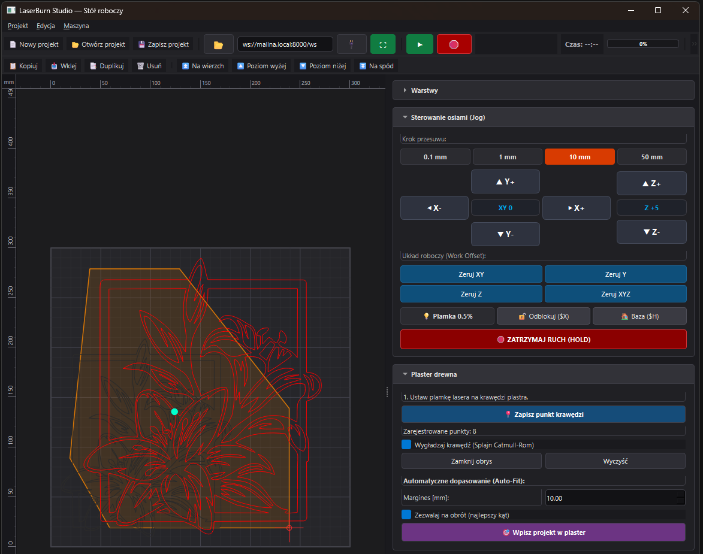
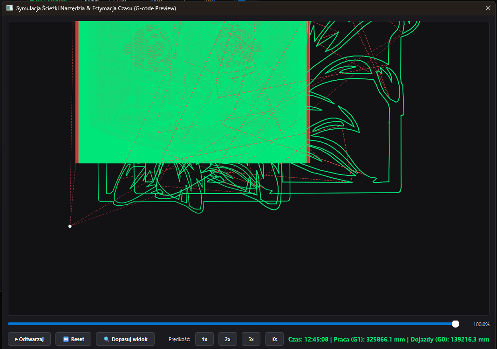
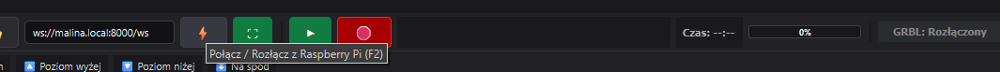

# 📖 Instrukcja Obsługi — LaserBurn Studio

Dokumentacja operacyjna i przewodnik użytkownika dla systemu CAD/CAM **LaserBurn Studio** (wersja 1.0).

## Spis Treści

 1. [Instalacja i Pierwsze Uruchomienie](#1-instalacja-i-pierwsze-uruchomienie)
 2. [Anatomia Interfejsu](#2-anatomia-interfejsu)
 3. [Nawigacja i Praca na Stole CAD](#3-nawigacja-i-praca-na-stole-cad)
 4. [Zarządzanie Obiektami i Schowek](#4-zarządzanie-obiektami-i-schowek)
 5. [Kształty Geometryczne i Symbole](#5-kształty-geometryczne-i-symbole)
 6. [Tabela Warstw Technologicznych](#6-tabela-warstw-technologicznych)
 7. [Baza Materiałów i Test Materiałowy](#7-baza-materiałów-i-test-materiałowy)
 8. [Import Geometrii (SVG oraz Raster)](#8-import-geometrii-svg-oraz-raster)
 9. [Procedura Mapowania Plastra Drewna](#9-procedura-mapowania-plastra-drewna)
10. [Przygotowanie do Wypalania (Framing i Symulacja)](#10-przygotowanie-do-wypalania-framing-i-symulacja)
11. [Sterowanie Maszyną i Bezpieczeństwo](#11-sterowanie-maszyną-i-bezpieczeństwo)
12. [Pliki i Dane Programu](#12-pliki-i-dane-programu)
13. [Skróty Klawiszowe](#13-skróty-klawiszowe)

---

## 1. Instalacja i Pierwsze Uruchomienie

### Wersja instalacyjna (zalecana – Windows 10/11, 64-bit)
Na komputerze docelowym **nie trzeba instalować Pythona ani żadnych bibliotek**.

* **Instalator** `LaserBurnStudio-1.0.0-setup.exe`:
  1. Uruchom instalator. Domyślnie program instaluje się dla bieżącego użytkownika i nie wymaga uprawnień administratora (w oknie można wybrać instalację dla wszystkich użytkowników).
  2. Opcjonalnie zaznacz ikonę na pulpicie oraz skojarzenie plików projektów `.lcam` – dwuklik na projekcie otworzy go w programie.
  3. Skrót **LaserBurn Studio** i **Instrukcja obsługi** pojawią się w menu Start.
  4. Deinstalacja: *Ustawienia → Aplikacje*. Baza materiałów użytkownika nie jest usuwana.
* **Wersja przenośna** `LaserBurnStudio-1.0.0-portable.zip`: rozpakuj w dowolnym katalogu (np. na pendrive) i uruchom `LaserBurnStudio.exe`.

> Przy pierwszym uruchomieniu Windows SmartScreen może ostrzec o nieznanym wydawcy (program nie jest podpisany certyfikatem). Wybierz *Więcej informacji → Uruchom mimo to*.

### Uruchomienie ze źródeł (Windows, Linux, macOS)
Wymagany Python 3.10 lub nowszy.

```bash
cd D:\dev\laserburn_studio
python -m venv .venv
.venv\Scripts\activate          # Linux/macOS: source .venv/bin/activate
pip install -r requirements.txt
python laserburn_studio.py
```

Na Windows można też użyć `uruchom.bat` (start z konsolą do diagnostyki).

### Budowanie instalatora
```bash
.venv\Scripts\python.exe -m pip install -r requirements-build.txt
.venv\Scripts\python.exe build.py
```
Skrypt `build.py` pakuje program PyInstallerem do `dist\LaserBurnStudio\`, usuwa zbędne moduły Qt, uruchamia spakowany program w trybie testowym (`--smoke-test`: kształty, import SVG, raster, G-code, zapis/odczyt projektu), tworzy archiwum przenośne, a jeśli zainstalowano [Inno Setup 6](https://jrsoftware.org/isdl.php) (`winget install JRSoftware.InnoSetup`) – również instalator. Opcje: `--no-installer`, `--no-test`.


> **Rysunek 1:** *Widok aplikacji z domyślnym stołem 300×300 mm.*

---

## 2. Anatomia Interfejsu

1. **Menu:** `Projekt`, `Edycja`, `Wstaw` (kształty), `Maszyna` (połączenie, framing, start, STOP, symulacja, test materiałowy, baza materiałów).

2. **Pasek Projektu i Maszyny (górny rząd):**
   * Pliki projektu: `📄 Nowy projekt`, `📂 Otwórz projekt...`, `💾 Zapisz projekt`.
   * Pole adresu mostka GRBL (`ws://malina.local:8000/ws`) oraz przycisk połączenia `⚡`.
   * Obrys plamką celującą `⛶`, start `▶` i zatrzymanie `🛑`.
   * Szacowany czas zadania, pasek postępu i plakietka telemetrii GRBL (stan, X, Y).

3. **Pasek Edycji (drugi rząd):**
   * Schowek: `📋 Kopiuj`, `📥 Wklej`, `📑 Duplikuj`, `🗑️ Usuń`.
   * Kolejność rysowania (Z-Order): `⏫ Na wierzch`, `🔼 Poziom wyżej`, `🔽 Poziom niżej`, `⏬ Na spód`.
   * Kształty: `╱` linia, `▭` prostokąt, `◯` elipsa, `⬡` wielokąt, `★` gwiazda, `♥` serce.

4. **Stół Roboczy CAD (centrum):**
   * Wymiary fizyczne w milimetrach, $X=0, Y=0$ w lewym dolnym rogu, oś $Y$ rośnie w górę.
   * Linijki dostosowujące podziałkę do powiększenia.
   * Celownik pokazujący pozycję głowicy w czasie rzeczywistym.

5. **Prawy Panel (harmonijka):**
   * **Warstwy:** wybór materiału z bazy, tabela warstw technologicznych, paleta kolorów C00–C07.
   * **Sterowanie osiami (Jog):** ruchy osi, plamka, odblokowanie, bazowanie, pauza/wznowienie/STOP zadania.
   * **Plaster drewna:** rejestracja krawędzi materiału i automatyczne wpisanie projektu (*Auto-Fit*).

---

## 3. Nawigacja i Praca na Stole CAD

* **Zoom:** kółko myszy – powiększa/oddala widok względem kursora.
* **Przesuwanie widoku:** przytrzymaj **środkowy przycisk myszy** i przeciągnij, albo przytrzymaj **Spację** i przeciągaj lewym przyciskiem.
* **Zaznaczanie:** kliknij kontur obiektu lub obejmij obiekty prostokątną ramką na wolnym tle. Pasek stanu pokazuje liczbę i łączne wymiary zaznaczenia.

---

## 4. Zarządzanie Obiektami i Schowek

Po zaznaczeniu obiektów pojawia się ramka przekształceń.

### Operacje geometryczne
* **Przesuwanie:** chwyć obiekt wewnątrz ramki. Krawędzie przyciągają się do siatki i sąsiednich obiektów (błękitne linie prowadzące).
* **Skalowanie proporcjonalne:** chwyć dowolny z 4 narożników – obiekt skaluje się względem przeciwległego narożnika.
* **Obrót:** zielony uchwyt nad ramką; z klawiszem `Shift` obrót skokowo co 15°.

### Schowek i kolejność (Z-Order)
* **Kopiuj (`Ctrl+C`) / Wklej (`Ctrl+V`):** wklejone obiekty są przesunięte o $+5$ mm w X i $-5$ mm w Y i zaznaczone.
* **Duplikuj (`Ctrl+D`):** kopiowanie i wklejenie w jednym kroku.
* **Usuń (`Delete` / `Backspace`):** usuwa tylko obiekty projektu (stół, siatka i celownik są chronione).
* **Z-Order:** `Ctrl+]` na wierzch, `Ctrl+[` na spód, `Ctrl+Up` / `Ctrl+Down` o jeden poziom.

---

## 5. Kształty Geometryczne i Symbole

Proste figury wstawia się z dokładnymi wymiarami – bez programu graficznego.

1. Kliknij symbol kształtu na pasku edycji lub wybierz go z menu **Wstaw** (prostokąt także `Ctrl+Shift+R`).
2. W oknie **Wstaw kształt** ustaw:

   | Kształt | Parametry |
   | :--- | :--- |
   | Linia | długość, kąt względem osi X |
   | Prostokąt | szerokość, wysokość, promień zaokrąglenia narożników |
   | Elipsa / okrąg | szerokość, wysokość (równe → okrąg) |
   | Wielokąt foremny | szerokość, wysokość, liczba boków (3–64), obrót |
   | Gwiazda | szerokość, wysokość, liczba ramion (3–64), promień wewnętrzny w % promienia zewnętrznego, obrót |
   | Serce | szerokość, wysokość |

   * Wymiary dotyczą **obrysu** kształtu; *Zachowaj proporcje* zmienia drugi wymiar razem z pierwszym.
   * **X / Y** to środek kształtu na stole – domyślnie środek widocznego fragmentu stołu.
   * **Warstwa** decyduje o kolorze, a więc o operacji (domyślnie warstwa zaznaczona w tabeli, a gdy żadna nie jest zaznaczona – warstwa cięcia).
   * Podgląd po prawej pokazuje kształt w kolorze warstwy. Program pamięta ostatnie wymiary do końca sesji.
3. Kliknij **Wstaw**. Kształt jest zwykłym obiektem wektorowym: można go przesuwać, skalować, obracać, kopiować i przenosić na inną warstwę paletą kolorów.

> Zamknięte kształty na warstwie **Fill** są kreskowane; linia (kształt otwarty) jest na warstwie Fill pomijana.

---

## 6. Tabela Warstw Technologicznych

LaserBurn Studio przypisuje parametry obróbki do obiektów na podstawie **koloru obrysu**.


> **Rysunek 2:** *Tabela warstw technologicznych oraz paleta szybkiego przypisywania C00–C07.*

Kolumny: nazwa (kolor), **Operacja**, **F** (posuw mm/min), **Moc** (%), **Pętla** (liczba przejść), **Kerf** (mm), **Wł.** (czy warstwa trafia do G-code).

### Operacje
1. **Cięcie** i **Linia** – obróbka po konturze (tryb Line). Laser pracuje w trybie dynamicznej mocy `M4`; przed każdym przejazdem jałowym `G0` wiązka jest gaszona (`M5`). Dwie osobne operacje pozwalają trzymać w bazie materiałów inne parametry do przecinania i do grawerowania linii.
2. **Fill** – kreskowanie wnętrza zamkniętych konturów. Podścieżki łączone są regułą parzystości, więc otwory (wnętrza liter, pierścienie) pozostają puste. Odstęp i kąt kreskowania pochodzą z bazy materiałów lub z testu materiałowego (domyślnie 0.1 mm, 0°).
3. **Raster** – grafiki rastrowe po ditheringu, skanowane dwukierunkowo w `M4` z dobiegiem 2.5 mm na nawrotach.

Kolejność ścieżek w warstwie optymalizowana jest metodą najbliższego sąsiada od bieżącej pozycji głowicy.

> **Kerf:** wartość jest zapisywana w warstwie i bazie materiałów, ale kompensacja szerokości rzazu nie jest jeszcze stosowana przy generowaniu G-code.

### Przypisanie obiektu do warstwy
1. Zaznacz obiekty na stole.
2. Kliknij kolor w palecie `C00`–`C07`. Jeśli warstwy w tym kolorze nie ma, zostanie dodana.

Przyciski pod tabelą: `➕ Dodaj warstwę`, `🎨 Zmień kolor`, `🗑️ Usuń`.

---

## 7. Baza Materiałów i Test Materiałowy

### Baza materiałów (`Ctrl+M`)
Zapamiętuje sprawdzone parametry dla materiałów – osobno dla operacji Cięcie, Linia, Fill i Raster.

* **Szybki wybór:** nad tabelą warstw wybierz materiał i kliknij **Zastosuj** – każda warstwa dostaje parametry operacji, którą ma ustawioną (np. warstwa „Cięcie” – posuw, moc, pętle i kerf cięcia).
* **Okno bazy** (`📚` lub *Maszyna → Baza materiałów...*):
  * lista materiałów oraz `➕ Nowy`, `⧉ Duplikuj`, `🗑 Usuń`;
  * nazwa, grubość, notatki i tabela operacji – zaznacz operacje, które materiał ma ustawiać;
  * `⬇ Pobierz z warstw` kopiuje bieżące ustawienia tabeli warstw do materiału;
  * `⬆ Zastosuj do warstw` zapisuje bazę i ustawia warstwy;
  * `💾 Zapisz`; przy zamykaniu z niezapisanymi zmianami program zapyta o zapis.
* Projekt pamięta wybrany materiał.

### Generator testu materiałowego (`Ctrl+T`)
Tworzy siatkę pól testowych do dobrania parametrów nowego materiału.

* **Tryb:** test cięcia (kontury) albo test wypełnienia (Fill).
* Zakres **mocy** (oś Y) i **prędkości** (oś X), liczba kroków w każdej osi, liczba przejść; dla Fill także odstęp i kąt kreskowania.
* Każde pole dostaje własną warstwę z opisem parametrów; obrys arkusza jest tylko pomocniczy (nie jest wypalany).
* Po teście wpisz najlepsze parametry do bazy materiałów.

---

## 8. Import Geometrii (SVG oraz Raster)

### Wektory SVG
* `Projekt → Importuj SVG...` lub `Ctrl+I`.
* Obiekty zachowują **położenie ze strony dokumentu**: lewy dolny róg strony SVG = punkt $X0\,Y0$ stołu.
* Jednostki są przeliczane z `viewBox` i wymiarów strony (mm, cm, in, pt, px przy 96 DPI); pliki z Adobe Illustratora zapisane w px rozpoznawane są jako 72 DPI.
* Kolor obiektu: kolor obrysu, a przy jego braku – kolor wypełnienia. Obiekty ukryte są pomijane. Pasek stanu podaje kolory, dla których nie ma warstwy (trafią na warstwę domyślną).
* **Wskazówka:** napisy przed zapisem warto zamienić na krzywe (Inkscape: `Ścieżka → Obiekt w ścieżkę`, `Ctrl+Shift+C`).

### Grafika rastrowa (PNG, JPG, BMP)
* `Projekt → Importuj grafikę rastrową...` (`Ctrl+Shift+I`).
* Orientacja z EXIF jest uwzględniana, przezroczystość zamieniana na biel (nie jest wypalana).
* Obraz jest zamieniany na 1-bitowy rastr algorytmem Floyd–Steinberga z krokiem 0.1 mm i dopasowywany do stołu.
* Wstawiany jest w punkcie $(50, 50)$ mm albo w środku zarejestrowanego plastra drewna.


> **Rysunek 3:** *Wektor SVG i grafika rastrowa po imporcie.*

---

## 9. Procedura Mapowania Plastra Drewna

Bezpieczne grawerowanie na materiałach o nieregularnym obwodzie.


> **Rysunek 4:** *Punkty brzegowe plastra oraz wyliczona otoczka z centroidem.*

1. Połóż plaster na stole i połącz się z maszyną (`F2`).
2. W panelu **Jog** włącz `💡 Plamka 0.5%`.
3. Przyciskami kierunkowymi naprowadź plamkę na krawędź materiału.
4. W panelu **Plaster drewna** kliknij `📍 Zapisz punkt krawędzi`.
5. Powtarzaj wokół obwodu (zalecane 8–16 punktów).
6. Kliknij `Zamknij obrys` – pojawi się wielokąt materiału i jego środek (opcja wygładzania splajnem Catmull–Rom).
7. Zaznacz projekt, ustaw **Margines** i kliknij `🎯 Wpisz projekt w plaster`. Projekt zostanie umieszczony w największym bezpiecznym miejscu materiału; przy włączonej opcji obrotu program wybiera najmniejszy obrót, który zapewnia dopasowanie. Rastry nie są obracane.

---

## 10. Przygotowanie do Wypalania (Framing i Symulacja)

### Framing (`F6`)
* Przycisk `⛶` lub **F6**: głowica ze słabą wiązką (`M3 S5`) objeżdża prostokąt obejmujący projekt z prędkością 2500 mm/min.
* Sprawdź, czy plamka przez cały czas pozostaje na materiale.

### Symulacja G-code (`F7`)
* **F7** lub `Maszyna → Podgląd ścieżek (Symulacja)...`.
* Linie zielone – przejazdy jałowe (`G0`), ciemnoczerwone – ruchy robocze (`G1`).
* Czas wykonania liczony jest modelem trapezoidalnym dynamiki osi.


> **Rysunek 5:** *Weryfikacja trajektorii w oknie symulacji G-code.*

### Eksport do pliku
`Projekt → Eksportuj plik G-code...` (`Ctrl+E`) zapisuje program do pliku `.nc` / `.gcode`.

---

## 11. Sterowanie Maszyną i Bezpieczeństwo

### Połączenie
Wpisz adres mostka (domyślnie `ws://malina.local:8000/ws`) i kliknij `⚡` lub **F2**. Mostek [grbl-bridge](https://github.com/merkato/grbl-bridge) działa na Raspberry Pi podłączonym do sterownika GRBL.


> **Rysunek 6:** *Pasek maszyny po nawiązaniu komunikacji z mostkiem.*

### Panel Jog
* Krok przesuwu, ruchy X/Y/Z, `XY 0` (przejazd do zera roboczego), `Z +5`.
* `💡 Plamka 0.5%`, `🔓 Odblokuj ($X)` (kasuje alarm lub potwierdza błąd zadania), `🏠 Baza ($H)`.
* Przyciski ruchu są aktywne tylko, gdy maszyna stoi i nie wykonuje zadania.

### Wypalanie
* `▶` lub **F5**: G-code jest kompilowany i przesyłany do mostka. Program nie pozwoli uruchomić drugiego zadania w trakcie trwającego.
* Pasek postępu i zegar pokazują pozostały czas. Zadanie kończy się dopiero, gdy maszyna wróci do stanu *Idle*, a nie po wysłaniu ostatniej linii.

### Pauza, wznowienie i STOP
* `⏸ Pauza` – *feed hold*: maszyna zatrzymuje się, zadanie zostaje w pamięci.
* `▶ Wznów` – kontynuacja po pauzie lub po zamknięciu drzwi/przycisku bezpieczeństwa (stan *Door*). Niedostępne po anulowaniu zadania.
* `🛑 STOP – ANULUJ I WYCZYŚĆ` (oraz `🛑` na pasku, klawisz **F12**):
  1. *Feed hold* `!` – osie hamują bez utraty kroków,
  2. po zatrzymaniu: *soft reset* GRBL – usuwa z bufora sterownika i mostka niewykonane linie, wyłącza laser,
  3. pozycja maszyny zostaje zachowana; w razie alarmu odblokuj sterownik `🔓 Odblokuj ($X)`.
* STOP wyprowadza maszynę z *Hold* także po użyciu sprzętowego przycisku bezpieczeństwa.

> Z mostkiem w wersji 2 sekwencję STOP wykonuje mostek (najszybciej). Ze starszym mostkiem program wykonuje ją sam i blokuje wznowienie po anulowaniu.

---

## 12. Pliki i Dane Programu

| Co | Gdzie |
| :--- | :--- |
| Projekt | plik `.lcam` (JSON) – geometria, położenie, obrót, kolory, warstwy, materiał, obrys plastra, rastry |
| Baza materiałów | `%USERPROFILE%\.laserburn_studio\materials.json` (kopia poprzedniej wersji: `.bak`); inna ścieżka: zmienna `LASERBURN_MATERIALS` |
| Log błędów | `%USERPROFILE%\.laserburn_studio\laserburn.log` – w razie nieoczekiwanego błędu program pokazuje komunikat i zapisuje szczegóły |

Zapis projektu i bazy jest atomowy (plik tymczasowy, potem podmiana), więc awaria w trakcie zapisu nie uszkodzi poprzedniej wersji. Projekty ze starszej wersji programu są wczytywane automatycznie.

---

## 13. Skróty Klawiszowe

| Skrót | Funkcja |
| :--- | :--- |
| `Ctrl + N` | Nowy projekt |
| `Ctrl + O` | Otwórz projekt (`.lcam`) |
| `Ctrl + S` | Zapisz projekt (`.lcam`) |
| `Ctrl + I` | Importuj SVG |
| `Ctrl + Shift + I` | Importuj grafikę rastrową |
| `Ctrl + E` | Eksportuj G-code |
| `Ctrl + C` / `Ctrl + V` | Kopiuj / Wklej |
| `Ctrl + D` | Duplikuj |
| `Delete` / `Backspace` | Usuń zaznaczone obiekty |
| `Ctrl + ]` / `Ctrl + [` | Na wierzch / Na spód |
| `Ctrl + Up` / `Ctrl + Down` | Poziom wyżej / niżej |
| `Ctrl + Shift + R` | Wstaw prostokąt |
| `Ctrl + M` | Baza materiałów |
| `Ctrl + T` | Generator testu materiałowego |
| `Spacja + przeciąganie` / środkowy przycisk | Przesuwanie widoku |
| `Kółko myszy` | Zoom względem kursora |
| `F2` | Połącz / rozłącz z mostkiem GRBL |
| `F5` | Start wypalania |
| `F6` | Framing (obrys plamką) |
| `F7` | Symulacja G-code |
| `F12` | **STOP – zatrzymanie i anulowanie zadania** |
