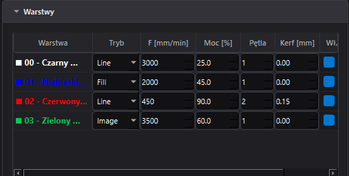

# 📖 Instrukcja Obsługi — LaserBurn Studio

Dokumentacja operacyjna i przewodnik użytkownika dla systemu CAD/CAM **LaserBurn Studio**.

## Spis Treści

 1. [Wymagania i Pierwsze Uruchomienie](#1-wymagania-i-pierwsze-uruchomienie)
 2. [Anatomia Interfejsu](#2-anatomia-interfejsu)
 3. [Nawigacja i Praca na Stole CAD](#3-nawigacja-i-praca-na-stole-cad)
 4. [Zarządzanie Obiektami i Schowek](#4-zarządzanie-obiektami-i-schowek)
 5. [Tabela Warstw Technologicznych](#5-tabela-warstw-technologicznych)
 6. [Import Geometrii (SVG oraz Raster)](#6-import-geometrii-svg-oraz-raster)
 7. [Procedura Mapowania Plastra Drewna](#7-procedura-mapowania-plastra-drewna)
 8. [Przygotowanie do Wypalania (Framing i Symulacja)](#8-przygotowanie-do-wypalania-framing-i-symulacja)
 9. [Sterowanie Maszyną i Bezpieczeństwo](#9-sterowanie-maszyną-i-bezpieczeństwo)
10. [Skróty Klawiszowe](#10-skróty-klawiszowe)

---

## 1. Wymagania i Pierwsze Uruchomienie

### Środowisko
* **System operacyjny:** Windows 10/11, Linux lub macOS.
* **Python:** wersja 3.10 lub nowsza.
* **Połączenie sieciowe:** z kontrolerem GRBL (mostek Raspberry Pi / WebSocket).

### Uruchomienie aplikacji
1. Otwórz terminal w katalogu projektu:
   ```bash
   cd D:\dev\laserburn_studio
   ```
2. Aktywuj wirtualne środowisko:
   ```bash
   # Windows
   .venv\Scripts\activate
   # Linux/macOS
   source .venv/bin/activate
   ```
3. Uruchom program:
   ```bash
   python laserburn_studio.py
   ```


> **Rysunek 1:** *Widok aplikacji po uruchomieniu z domyślnym stołem 300x300 mm.*

---

## 2. Anatomia Interfejsu

Interfejs LaserBurn Studio został zoptymalizowany pod kątem szybkiej obsługi warsztatowej i podzielony na cztery główne obszary:


> **Rysunek 2:** *Układ ekranu: Pasek Maszyny (góra-lewo), Pasek Edycji (drugi wiersz), Stół CAD (centrum) i Panel Warstw/Jog/Plaster (prawo).*

1. **Pasek Projektu i Maszyny (Górny rząd):**
   * Pliki projektu: `📄 Nowy projekt`, `📂 Otwórz projekt...`, `💾 Zapisz projekt`.
   * Przycisk importu wektorów `📂` (`Ctrl+I`).
   * Pole adresu mostka GRBL (`ws://malina.local:8000/ws`) oraz przycisk połączenia `⚡`.
   * Przycisk obrysu fizycznego plamką celującą `⛶` (*Framing 0.5%*).
   * Przyciski startu `▶` oraz natychmiastowego zatrzymania `🛑`.
   * Zegar szacowanego czasu zadania, pasek postępu i plakietka telemetrii GRBL.

2. **Pasek Narzędzi Edycji Graficznej (Drugi rząd):**
   * Narzędzia schowka: `📋 Kopiuj`, `📥 Wklej`, `📑 Duplikuj`, `🗑️ Usuń`.
   * Narzędzia poziomów renderowania (Z-Order): `⏫ Na wierzch`, `🔼 Poziom wyżej`, `🔽 Poziom niżej`, `⏬ Na spód`.

3. **Stół Roboczy CAD (Centrum):**
   * Obszar roboczy z fizycznymi wymiarami w milimetrach ($Y=0$ w lewym dolnym rogu).
   * Dynamiczne linijki milimetrowe dostosowujące podziałkę do stopnia powiększenia widoku.
   * Czerwony celownik `LaserCrosshairItem` wskazujący fizyczną pozycję wiązki w czasie rzeczywistym.

4. **Prawy Panel Narzędziowy (Harmonijka):**
   * **Warstwy:** parametry posuwu, mocy, pętli, rzazu oraz trybu (`Line`, `Fill`, `Image`).
   * **Sterowanie osiami (Jog):** ręczne przemieszczanie osi z krokiem od 0.1 mm do 50 mm.
   * **Plaster drewna:** rejestracja punktów krawędzi, wyznaczanie otoczki geometrycznej oraz autowpisanie (*Auto-Fit*).

---

## 3. Nawigacja i Praca na Stole CAD

* **Przybliżanie / Oddalanie (Zoom):**
  * Obróć kółko myszy w przód, aby powiększyć widok pod wskaźnikiem kursora.
  * Obróć kółko myszy w tył, aby oddalić widok stołu.
* **Przesuwanie widoku (Panoramowanie / Pan):**
  * Wciśnij i przytrzymaj **Środkowy Przycisk Myszy (ŚPM)**, a następnie przeciągaj stół.
  * *Alternatywnie:* Przytrzymaj klawisz **Spacja**, wciśnij **Lewy Przycisk Myszy (LPM)** i przeciągaj stół.
* **Zaznaczanie obiektów:**
  * Kliknij bezpośrednio na kontur lub wypełnienie wybranego elementu.
  * Wciśnij LPM na wolnym tle stołu i przeciągnij, aby objąć obiekty prostokątną ramką zaznaczenia (*Rubber-Band Selection*).


> **Rysunek 3:** *Przeciąganie ramki zaznaczenia obejmującej kilka wektorów jednocześnie.*

---

## 4. Zarządzanie Obiektami i Schowek

Po zaznaczeniu jednego lub wielu elementów na stole uaktywnia się manipulator przekształceń `TransformBoxItem`:


> **Rysunek 4:** *Manipulator transformacji: uchwyty skalowania narożnikowego, obrys bounding-box oraz zielony uchwyt obrotu.*

### Operacje geometryczne
* **Przesuwanie:** Chwyć element wewnątrz ramki i przeciągnij go. Moduł `SnapEngine` automatycznie przyciągnie krawędzie do siatki stołu lub sąsiednich obiektów (zasygnalizowane błękitnymi liniami prowadzącymi).
* **Skalowanie proporcjonalne:** Chwyć za dowolny z 4 narożników. Obiekt przeskaluje się płynnie względem przeciwległego wierzchołka bazowego (*pivot*).
* **Obrót:** Chwyć za zielony uchwyt rotacji nad górną krawędzią. Przytrzymanie klawisza `Shift` wymusza skok obrotu o wielokrotność 15°.

### Schowek i kolejność warstw (Z-Order)
* **Kopiuj (`Ctrl+C`):** Zapisuje kompletną geometrię ścieżki, styl pióra, pozycję i metadane do wewnętrznego bufora aplikacji.
* **Wklej (`Ctrl+V`):** Wstawia skopiowane obiekty z przesunięciem $+5\text{ mm}, -5\text{ mm}$ i automatycznie je zaznacza.
* **Duplikuj (`Ctrl+D`):** Wykonuje operację szybkiego powielenia zaznaczenia w jednym kroku.
* **Usuń (`Delete` / `Backspace`):** Usuwa wyłącznie zaznaczone obiekty projektowe (chroniąc stół roboczy, siatkę i elementy celownika).
* **Zarządzanie głębokością (Z-Order):**
  * `⏫ Na wierzch` (`Ctrl+]`): przenosi obiekt ponad wszystkie pozostałe elementy robocze.
  * `⏬ Na spód` (`Ctrl+[`): przenosi obiekt na najniższą warstwę roboczą (ponad podłoże stołu i obrys plastra).
  * `🔼 Poziom wyżej` (`Ctrl+Up`) / `🔽 Poziom niżej` (`Ctrl+Down`): stopniowa zmiana głębokości o 1 poziom.

---

## 5. Tabela Warstw Technologicznych

LaserBurn Studio przypisuje parametry obróbki do geometrii na podstawie koloru jej obrysu.


> **Rysunek 5:** *Tabela warstw technologicznych oraz paleta szybkiego przypisywania C00–C07.*

### Dostępne tryby pracy warstwy
1. **Line (Cięcie / Obrys):**
   * Wykonuje cięcie wektorowe ze stałą mocą (`M3`).
   * Uwzględnia parametr `Kerf [mm]` (kompensacja szerokości rzazu) oraz `Pętla` (liczba przejść po tym samym torze).
2. **Fill (Wypełnienie wektorowe):**
   * Wykonuje kreskowanie wnętrza zamkniętych figur.
3. **Image (Raster):**
   * Dedykowany dla grafik rastrowych poddanych ditheringowi.
   * Uruchamia szybkie skanowanie dwukierunkowe w trybie dynamicznej mocy (`M4`) z marginesami rozbiegowymi (`overscan`).

### Błyskawiczne przypisanie warstwy
1. Zaznacz element lub grupę wektorów na stole roboczym.
2. Kliknij żądany kolor w palecie szybkiego wyboru (`C00`–`C07`).
3. Obrys obiektu przyjmie wybrany kolor, a silnik CAM automatycznie przypisze go do odpowiedniego wiersza technologicznego.

---

## 6. Import Geometrii (SVG oraz Raster)

### Wektory SVG (Inkscape)
* Uruchom import przez `Projekt -> Importuj SVG...` lub skrótem `Ctrl+I`.
* Moduł `SvgDocumentImporter` automatycznie przelicza jednostki z 96 DPI na milimetry oraz inwertuje oś $Y$ pod fizyczny układ maszyny.
* Kolory ścieżek z Inkscape zostaną odczytane i powiązane z tabelą warstw.
* **Wskazówka:** Napisy tekstowe w Inkscape przed zapisem pliku warto zamienić na krzywe (`Ścieżka -> Obiekt w ścieżkę` / `Ctrl+Shift+C`).

### Grafika rastrowa (PNG, JPG, BMP)
* Wybierz `Projekt -> Importuj grafikę rastrową...` (`Ctrl+Shift+I`).
* Silnik `RasterImageProcessor` dokona 1-bitowej kwantyzacji rozproszenia błędu algorytmem Floyd-Steinberga.
* Obraz zostanie wstawiony w punkcie $(50, 50)$ mm lub automatycznie w środku geometrycznym (centroidzie) zarejestrowanego plastra.


> **Rysunek 6:** *Zaimportowany wektor SVG oraz przetworzona grafika rastrowa na stole roboczym.*

---

## 7. Procedura Mapowania Plastra Drewna

Funkcja umożliwiająca bezpieczne i estetyczne grawerowanie na plastrach pnia o nieregularnym, naturalnym obwodzie:


> **Rysunek 7:** *Wyznaczone punkty brzegowe plastra drewna oraz wyliczona otoczka Convex Hull z centroidem.*

### Procedura postępowania:
1. Umieść plaster drewna na stole roboczym urządzenia.
2. Połącz aplikację z kontrolerem (`F2`). Włącz plamkę pilotującą o mocy 0.5% (przycisk `💡 Plamka 0.5%` w panelu Jog).
3. Używając przycisków kierunkowych w panelu **Jog**, naprowadź plamkę celownika dokładnie na brzeg kory materiału.
4. W panelu **Plaster drewna** kliknij `📍 Zapisz punkt krawędzi`.
5. Przemieszczaj głowicę wzdłuż krawędzi plastra i rejestruj kolejne punkty (zalecane: od 8 do 16 punktów wokół całego obwodu).
6. Kliknij `Zamknij obrys`:
   * Na stole pojawi się bursztynowy wielokąt materiału.
   * Turkusowy punkt wskaże wyliczony środek ciężkości (centroid).
7. Zaznacz projekt i kliknij `🎯 Wpisz projekt w plaster`:
   * Grafika zostanie proporcjonalnie dopasowana z zachowaniem zadanego marginesu od kory (`Margines [mm]`) i precyzyjnie wyśrodkowana w materiale.

---

## 8. Przygotowanie do Wypalania (Framing i Symulacja)

Przed załączeniem pełnej mocy lasera wykonaj weryfikację geometrii i czasów:

### 1. Fizyczny Framing materiału (`F6`)
* Kliknij przycisk `⛶` na pasku maszyny lub wciśnij klawisz **F6**.
* Głowica lasera z włączoną bezpieczną wiązką pilotującą ($0.5\%$, komenda `M3 S5`) z prędkością $2500\text{ mm/min}$ objedzie prostokąt graniczny projektu.
* Sprawdź wzrokowo, czy plamka przez cały czas mieści się na płaszczyźnie materiału.

### 2. Symulacja G-code (`F7`)
* Wciśnij **F7** lub wybierz z menu `Maszyna -> Podgląd ścieżek (Symulacja)...`.
* Zostanie otwarte okno wizualizera z podglądem trajektorii:
  * Linie zielone: szybkie przeloty jałowe (`G0`).
  * Linie ciemnoczerwone: ruchy robocze z załączoną wiązką (`G1`).
  * Wyświetlony zostanie dokładny estymowany czas wykonania zadania liczony modelem trapezoidalnym dynamiki osi.


> **Rysunek 8:** *Weryfikacja trajektorii w oknie symulacji G-code z kalkulacją czasu cyklu.*

---

## 9. Sterowanie Maszyną i Bezpieczeństwo

### Połączenie sieciowe
Wpisz adres mostka WebSocket (np. `ws://malina.local:8000/ws`) i kliknij `⚡` (lub skrót **F2**).


> **Rysunek 9:** *Pasek maszyny po nawiązaniu komunikacji z mostkiem GRBL.*

### Rozpoczęcie wypalania
* Kliknij zielony przycisk `▶` na pasku maszyny lub wciśnij klawisz **F5**.
* Kod G-code zostanie skompilowany i przesłany protokołem HTTP do usługi wykonawczej mostka.
* Przycisk zmieni stan na `⏳`, a pasek postępu i zegar telemetrii zaczną odliczać czas obróbki.

### Zatrzymanie awaryjne (E-STOP)
W przypadku zacięcia mechaniki, zapalenia materiału lub utraty kontroli:
1. Natychmiast wciśnij klawisz **F12** lub kliknij czerwony przycisk `🛑 ZATRZYMAJ RUCH (HOLD)`.
2. Aplikacja nada priorytetowy pakiet poleceń GRBL:
   * `!` — Feed Hold (zatrzymanie posuwu osi w ułamku sekundy).
   * `M5` — Natychmiastowe odcięcie zasilania lasera.
   * `\x85` — Wyczyszczenie bufora kroków Jog.
3. Po usunięciu zagrożenia odblokuj kontroler przyciskiem `🔓 Odblokuj ($X)`.

---

## 10. Skróty Klawiszowe

| Skrót | Funkcja |
| :--- | :--- |
| `Ctrl + N` | Nowy projekt (czyszczenie stołu roboczego) |
| `Ctrl + O` | Otwórz zapisany plik projektu (`.lcam`) |
| `Ctrl + S` | Zapisz bieżący projekt (`.lcam`) |
| `Ctrl + I` | Importuj plik wektorowy SVG |
| `Ctrl + Shift + I` | Importuj grafikę rastrową (PNG, JPG, BMP) |
| `Ctrl + E` | Eksportuj scalony kod G-code do pliku (`.nc`) |
| `Ctrl + C` | Kopiuj zaznaczone obiekty do schowka |
| `Ctrl + V` | Wklej obiekty ze schowka (z przesunięciem) |
| `Ctrl + D` | Duplikuj zaznaczenie (klonowanie w locie) |
| `Delete` / `Backspace` | Usuń zaznaczone obiekty projektu |
| `Ctrl + ]` | Przenieś obiekt na sam wierzch (Z-Order) |
| `Ctrl + [` | Przenieś obiekt na spód (Z-Order) |
| `Ctrl + Up` | Przesuń warstwę obiektu o jeden poziom wyżej |
| `Ctrl + Down` | Przesuń warstwę obiektu o jeden poziom niżej |
| `Spacja + Przeciąganie LPM` | Płynne przesuwanie stołu roboczego (Pan) |
| `Rolka myszy` | Płynny zoom względem pozycji kursora |
| `F2` | Połącz / Rozłącz komunikację z mostkiem GRBL |
| `F5` | Start wypalania (Kompilacja i wysłanie zadania) |
| `F6` | Framing (Fizyczny obrys granic materiału plamką 0.5%) |
| `F7` | Otwórz okno symulacji i weryfikacji G-code |
| `F12` | **E-STOP (Zatrzymanie awaryjne i odcięcie lasera)** |